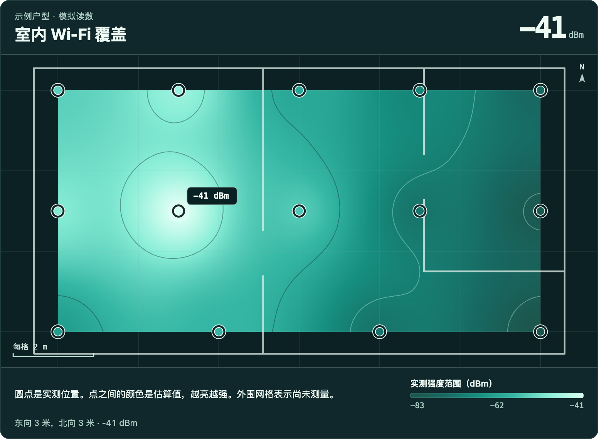
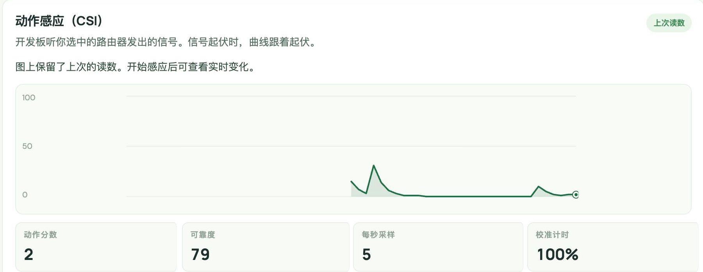

# ESP32 Marauder for XIAO ESP32-C5

拿着一块 Seeed Studio XIAO ESP32-C5 从门口走到书桌，哪里 Wi-Fi 最强？同一个路由器的 5 GHz 信号，隔一堵墙还剩多少？这个版本把 ESP32 Marauder 的无线测量带进电脑浏览器。XIAO 负责接收信号，USB 把读数送到中英文控制台，在那里可以画 Wi-Fi 和低功耗蓝牙（BLE）覆盖图、比较两个 Wi-Fi 频段，也可以观察走动时的信号变化。



*模拟户型，14 个测点。圆点标出采样位置，点之间的颜色是估算值。左侧亮区的信号最强，测量范围外留空。*

## 先打开控制台

在仓库根目录运行下面的命令，再用桌面版 Chrome 或 Edge 打开控制台。电脑需要 Python 3。

```sh
python3 -m http.server 8765 --bind 127.0.0.1 --directory xiao-console
```

- **先看效果**　打开[热力图示例](http://127.0.0.1:8765/?map=example#advanced)，点不同的圆点就能看坐标和强度。只需电脑就能试。
- **开始实测**　准备一块已烧录本分支 XIAO 固件的开发板，用 USB-C 数据线接到电脑。打开[本地控制台](http://127.0.0.1:8765/)，点 **连接设备**，选中开发板串口，再进入 **高级工具**。
- **准备固件**　从源码构建时，选择 `XIAO_ESP32C5` 板型和 Arduino-ESP32 `3.3.4`。本仓库的构建配置列出了 `Seeed XIAO ESP32-C5` 的依赖、8 MB 分区和 USB 设置。[固件源码](esp32_marauder/esp32_marauder.ino) · [板型与构建配置](.github/workflows/build_parallel.yml)

## 画自己的 Wi-Fi 或蓝牙覆盖图

1. 在 **信号强度地图 → 我的实测** 选 Wi-Fi 或 BLE，点 **开始监听**，再选要测的接入点或蓝牙设备。地图按无线地址区分设备，即使两个接入点用了相同的名字也能分别测量。
2. 把门口定为 `(0, 0)`，点 **记录此处**，拿稳开发板。收到所选设备的下一条广播后，页面就会显示这个点的强度。每次最多等 30 秒。
3. 拿着开发板向东走 2 米，在地图上点新位置，或输入 `(2, 0)`，再记一次。两处能看沿线强弱。从这里向北走 2 米，在 `(2, 2)` 记第三次，三个点围成的区域就会出现热力图。

比例尺随测点间距调整，颜色取当前地图各位置最新读数的最弱值到最强值。回到同一位置复测，地图更新该点的颜色，历史读数都保留在明细里。室外可填经纬度，也可让放在开发板旁边的电脑提供位置。记录保存在当前浏览器的同一站点，可导出 CSV。

## 比较同名 Wi-Fi 的两个频段

在 **双频巡检** 中运行 **开始双频巡检**。扫描结束后，每行对应一个网络名称，两列分别显示 2.4 GHz 和 5 GHz 的信号强度与信道。同一名称在一个频段有多个接入点时，取其中最强的一个。


*演示数据。Demo-Studio 在 5 GHz 为 −43 dBm，在 2.4 GHz 为 −54 dBm，前者强 11 dB。点 **记下这个位置** 后换个房间再扫，括号里的 `+3` 表示该频段比上个位置强了 3 dB。*

## 用 CSI 看走动时的信号变化

CSI（信道状态信息）能反映 Wi-Fi 信号在路由器与开发板之间的传播变化。在 **动作感应（CSI）** 中选自己的接入点，再选感应方式。两种方式共用同一份扫描结果。

- **被动监听（免密码）**　开发板监听所选接入点。先让周围保持静止约 30 秒，再从开发板和路由器之间走过。隐藏网络可手填无线地址（BSSID）和信道。
- **网关自测（60 秒）**　想先确认能否采到数据，可选开发板上已保存的 Wi-Fi，启动自测。开发板向当前网关发送普通 Ping。前 30 秒保持静止，后半段再走动，结束后曲线会留在页面上。



*真机网关自测。先看 **每秒采样**，大于 0 表示正在收到样本。再看 **动作分数**，`—` 表示当前没有可用分数，`0` 是有效读数。图中末次读数为每秒 5 个样本、动作分数 2。*

## 其他入口

基础命令页可以逐项查看命令用途、运行扫描、筛选 Wi-Fi 结果并导出 Wi-Fi 或蓝牙清单。高级工具还支持将 USB 抓包保存为电脑上的 PCAP 文件，以及查看外接 GPS 模块的定位状态。操作步骤见[控制台指南](xiao-console/README.md)。

本项目基于 JustCallMeKoko 的 [ESP32 Marauder](https://github.com/justcallmekoko/ESP32Marauder)。其他 Marauder 硬件和通用固件文档见[上游 Wiki](https://github.com/justcallmekoko/ESP32Marauder/wiki)，项目采用 [MIT 许可证](LICENSE)。
