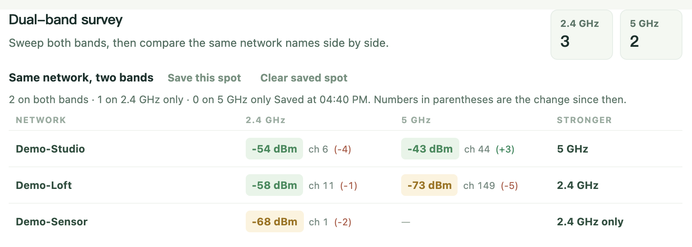

# ESP32 Marauder for XIAO ESP32-C5

Carry a Seeed Studio XIAO ESP32-C5 from the doorway to your desk and measure how the Wi-Fi signal changes along the way. This fork pairs Marauder firmware with a local browser console. The board takes the readings and sends them over USB. In the console you can map Wi-Fi or Bluetooth Low Energy (BLE) coverage, compare 2.4 GHz with 5 GHz, and watch how movement affects a Wi-Fi link. The interface is available in English and Simplified Chinese.


*Built-in example with 14 simulated readings. Each dot marks a sampling location. Brighter areas show stronger reception, and the shading between dots estimates coverage. The grid outside the sampled area stays empty.*

## Open the console

From the repository root, start the local server with Python 3 and open it in desktop Chrome or Edge.

```sh
python3 -m http.server 8765 --bind 127.0.0.1 --directory xiao-console
```

- **Try it without a board.** Open the heatmap example and select a dot to see its coordinates and signal strength. [Open the local example](http://127.0.0.1:8765/?map=example#advanced)
- **Take live readings.** Connect a XIAO ESP32-C5 running this fork’s firmware with a USB-C data cable. Open the console, click **Connect device**, select the board’s serial port, then open **Advanced tools**. [Open the local console](http://127.0.0.1:8765/)
- **Build the firmware.** Select the `XIAO_ESP32C5` board with Arduino-ESP32 `3.3.4`. The `Seeed XIAO ESP32-C5` entry in the build workflow lists the dependencies, 8 MB partition scheme, and USB settings. [Firmware source](esp32_marauder/esp32_marauder.ino) · [Build configuration](.github/workflows/build_parallel.yml)

## Map Wi-Fi or BLE coverage

1. Open **Signal strength map → My survey**. Choose Wi-Fi or BLE, click **Start listening**, then select your access point or BLE device. The console tracks its radio address, so you can measure two access points separately even if they share a name.
2. Use the doorway as your origin `(0, 0)`. Click **Record this spot** and hold the board still. The console waits up to 30 seconds for the next broadcast from the selected device and saves its signal strength at that spot.
3. Walk 2 metres east. Click the new location on the grid or enter `(2, 0)`, then record again. Two points show signal strength along the line between them. Walk 2 metres north and record at `(2, 2)` to see a shaded coverage area inside the triangle.

The grid scale adjusts to the distance between locations. The colour scale spans the weakest and strongest of the latest readings at each spot. Measuring a spot again updates its colour and keeps every reading in the history. Outdoors, enter coordinates or use the browser’s location with the computer beside the board. The same browser keeps your survey at the same local address, and you can export the readings to CSV.

## Compare 2.4 GHz and 5 GHz

Open **Dual-band survey** and run **Start dual-band survey**. Each row groups readings by Wi-Fi name and shows the signal strength and channel on each band. If several access points use the same name on one band, the table shows the strongest one observed on that band.



*Simulated survey. Demo-Studio reads −43 dBm on 5 GHz and −54 dBm on 2.4 GHz, so 5 GHz is 11 dB stronger here. Click **Save this spot** and scan again in another room. The `+3` beside the 5 GHz reading means it gained 3 dB since the saved survey.*

## Watch movement with CSI

Channel state information (CSI) describes how a Wi-Fi signal travels between the access point and the board. In **Motion sensing (CSI)**, select your own access point and choose a sensing mode. Both modes use the same scan results.

- **Passive listening (no password).** Keep the board and its surroundings still for about 30 seconds to establish a baseline, then walk between the board and the router. For a hidden network, you can enter its radio address (BSSID) and channel.
- **Gateway self-test (60 seconds).** To check that samples are coming through, choose a network already saved on the board. During the test, the board sends ordinary pings to its gateway. Keep still for the first 30 seconds, then walk through the link. The last curve stays visible when the test ends.


*Recorded on hardware. A **SAMPLES/S** value above zero means samples are arriving. Under **MOTION**, a dash means the board has no usable score yet, while `0` is a valid score. This run ended at 5 samples per second with a motion score of 2.*

## More tools and documentation

Basic commands include timed scans and device lists. You can filter Wi-Fi results and export Wi-Fi or Bluetooth inventories to CSV. Advanced tools can save a USB packet capture as a PCAP file on your computer or show the fix status of an external GPS module. [Console guide](xiao-console/README.md)

This fork builds on JustCallMeKoko’s ESP32 Marauder. See the upstream project and wiki for other Marauder hardware and general firmware documentation. [Upstream project](https://github.com/justcallmekoko/ESP32Marauder) · [Upstream wiki](https://github.com/justcallmekoko/ESP32Marauder/wiki) · [MIT license](LICENSE)
